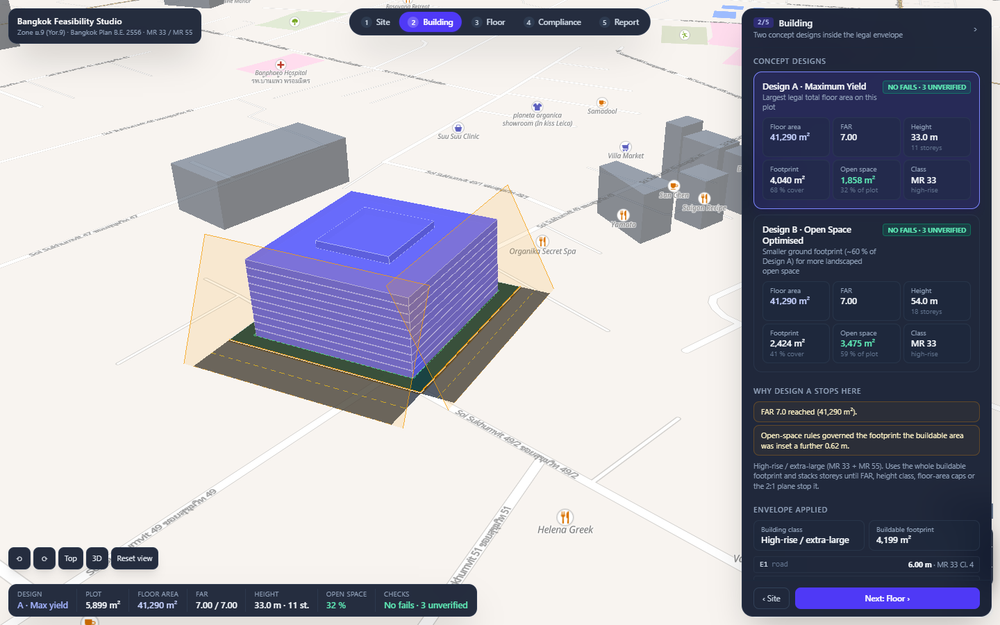

# Bangkok Feasibility Studio: ย.9 (Yor.9) 3D zoning & massing

A browser tool that answers a developer's first question about a Bangkok plot: **what can legally be built here, how much, and what might it look like?** Draw any plot on a real 3D map of Bangkok, mark the road(s) it faces, pick a building type. The tool then:

- applies the zoning and building-control rules for zone **ย.9 (high-density residential)**;
- shows the legal building envelope;
- generates two concept designs, each with its own rule-by-rule compliance checklist.

> **Pre-design estimate only, not legal advice or a permit determination.** The plot's zone is *user-declared* and not checked against the official land-use map. Read [Limitations](#limitations-and-regulatory-disclaimers) before relying on any figure.



## Features

- **Any plot shape.** Draw rectangles, trapezoids or concave and irregular polygons. Vertex markers and the live preview appear on the first click. Undo, cancel, finish, close-on-first-point, draggable vertices, self-intersection prevention and live area are all supported.
- **Real site context.** OpenStreetMap buildings in 3D via OpenFreeMap. Buildings inside the plot are hidden, and plots crossing mapped roads get a warning.
- **Per-road frontage.** Each road-facing edge has its own reserve width, for example a corner plot on 18 m and 12 m roads.
- **Rules engine.** Implements:
  - Bangkok Comprehensive Plan B.E. 2556, Clause 16 (FAR 7, OSR 4.5 %, use limits);
  - Ministerial Regulation 55 (road and boundary setbacks, the 2:1 sky-exposure plane with two-road relief, open space);
  - Ministerial Regulation 33 (high-rise / extra-large thresholds, road eligibility, 6 m setbacks, open space);
  - EIA thresholds, as information only.
- **Two designs.**
  - *A · Maximum Yield* gives the most legal floor area and explains what limits it.
  - *B · Open Space Optimised* uses at most about 60 % of A's footprint and recovers floor area with height where the road allows.
- **Compliance checklist per design.** Actual vs required values, **PASS / FAIL / UNVERIFIED / INFO**, the clause, a source link, and a 3D highlight of the related geometry. Missing evidence is never shown as PASS.
- **Floor inspection.** Per-storey polygons and areas, a 2D plan showing four layers (plot, buildable area, allowable envelope, storey), a cutaway view, and an area schedule that reconciles exactly with total floor area.
- **Report.** Design A vs B comparison, schedules, assumptions, legal sources and JSON export.
- **Live updates.** The engine runs in a Web Worker, so changes to plot, roads or building type update everything without a reload.

## Technology

React 19 · TypeScript · Vite 6 · Tailwind CSS 4 · MapLibre GL JS 5 + OpenFreeMap tiles · Three.js (MapLibre custom layer) · polygon-clipping · Vitest · Playwright-core (browser checks) · Cloudflare Pages + Pages Functions.

The rules engine (`src/engine/`) is pure, deterministic TypeScript. The browser, the Web Worker and the API all call the same `runFeasibility()`.

## Getting started

Requires Node.js ≥ 20 (`.nvmrc` pins 22). No API keys or environment variables are needed.

```bash
npm ci
npm run dev        # http://localhost:5173
```

| Command | What it does |
|---|---|
| `npm run dev` | Vite dev server |
| `npm test` | Vitest: geometry, regulatory reference cases, design invariants, state machine, API |
| `npm run lint` | TypeScript checks for the app and the Cloudflare Function |
| `npm run build` | Typecheck + production build to `dist/` |
| `npm run preview` | Serve the production build locally |
| `npm run e2e` | Browser checks against the production build (needs `npm run build` and Microsoft Edge installed) |

To run the site and the API together in Cloudflare's local runtime: `npm run build && npx wrangler pages dev dist`.

## API

`POST /api/evaluate` runs on Cloudflare Pages Functions (`functions/api/evaluate.ts`) and calls the same engine as the browser.

```json
{
  "polygon": [[100.5755, 13.7305], [100.5762, 13.7305], [100.5762, 13.7312], [100.5755, 13.7312]],
  "roadEdges": [{ "edgeIndex": 0, "widthM": 18 }, { "edgeIndex": 1, "widthM": 12 }],
  "buildingType": "high-rise-condo",
  "nearTransitDeclared": false
}
```

- `polygon`: `[lng, lat]` pairs (≥ 3, any winding).
- `roadEdges[].edgeIndex`: edge *i* runs from vertex *i* to vertex *i+1*.
- `buildingType`: one of `low-rise-condo`, `high-rise-condo`, `commercial-office`, `mixed-use`.
- Legacy form: `"roadEdges": [0, 1]` with a single `"roadWidth": 12`.

| Status | Meaning |
|---|---|
| 200 | Full feasibility result: site, both designs, floors and checklists |
| 400 | Malformed input |
| 422 | Geometrically invalid plot (e.g. self-intersecting) |
| 405 | Method other than POST or OPTIONS |

CORS is open.

## Deploying to Cloudflare Pages

| Setting | Value |
|---|---|
| Framework preset | React (Vite) |
| Build command | `npm run build` |
| Build output directory | `dist` |
| Root directory | repository root |
| Functions | `functions/` (detected automatically) |
| Environment variables | none required (optionally `NODE_VERSION=22`) |

`public/_routes.json` sends only `/api/*` to the Function; every other path is served as static assets.

## Project structure

```
src/engine/        rules engine (regulations.ts holds every legal constant and its source)
src/scene/         Three.js scene builder
src/components/    map, stage panels, UI
functions/api/     Cloudflare Pages Function
tests/             Vitest suites
e2e/               browser verification script
docs/              regulatory research, audit findings, architecture, decisions, screenshots
```

## Limitations and regulatory disclaimers

- **The zone is UNVERIFIED.** The 2013 plan defines ย.9 areas only on its annexed map, and no official machine-readable boundary was publicly available. The tool can only detect plots outside Bangkok. Confirm the zone with the BMA City Planning Department.
- **Plan version.** The 2013 plan is still operative. Its 4th revision (in public posting until 9 Nov 2026) is expected to change ย.9 values, so re-run the analysis once it is promulgated.
- **Bangkok Building Control Ordinance B.E. 2544** could not be text-verified (the official copy is a scanned image). Stricter Bangkok-specific rules are not modelled and appear as UNVERIFIED on every checklist.
- **EIA thresholds** were read from the 2018 notification. Their carry-over into the in-force 2023 notification is assumed, not verified. Unit counts and usable area are estimates. The EIA result is information, not a design limit.
- **Road widths are user inputs** and plot edges are assumed to be road boundaries. OpenStreetMap is navigation data, not a cadastral survey. Presets are synthetic test parcels, not surveyed title deeds.
- **Not modelled:** parking, basements, floor-area exclusions, FAR bonuses, parapets and rooftop structures, permeable-surface layout, detailed fire and structural requirements.
- **Assumption:** all walls are treated as having openings, so the window setbacks apply to every boundary.

The clause text, calculations, sources and verification status are in [`docs/regulatory-research.md`](docs/regulatory-research.md). The audit trail is in [`docs/audit-findings.md`](docs/audit-findings.md).

Map data © OpenStreetMap contributors, tiles by OpenFreeMap. The fallback basemap is © CARTO.
